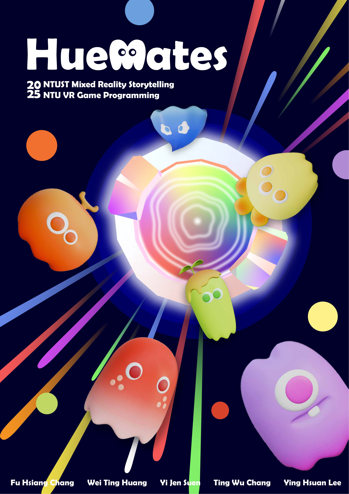

# HueMates 🎨👻

**A mixed-reality game about color spirits — made by NTU × NTUST students (2025).**

A collaboration between *NTUST Mixed Reality Storytelling* (narrative & art) and *NTU VR Game Programming* (development). Players step into a colorful world of hue spirits and interact with them through rings, portals and color-switching mechanics in VR.

  
   
  ▶️ <a href="https://youtu.be/T2s1jHeiLac"><b>Watch the demo video</b></a>

## Poster

  

📄 Full poster: [docs/HueMates_poster.pdf](docs/HueMates_poster.pdf)

## Gameplay

Color spirits (the *HueMates*) wander around the player in mixed reality. Using the VR controllers, players form and squeeze rings, switch colors, and guide spirits of matching hues — bringing them home through a glowing rainbow portal.

## Tech

- **Unity (C#)** with XR Interaction Toolkit — built for VR headsets
- Flocking-style spirit behaviour (separation/steering tuned per spirit prefab)
- Custom ring mechanics: `RingFormer`, `QuarterRing`/`FullRing`, networked ring squeezing
- Color-switch interaction, wormhole/meteor spawners, custom bubble shader

## Team

Fu Hsiang Chang · Wei Ting Huang · Yi Jen Suen · Ting Wu Chang · Ying Hsuan Lee

My part (Wei Ting Huang): spirit/fairy behaviour and movement systems, spirit prefab tuning, ring mechanics co-development, and scene integration.
